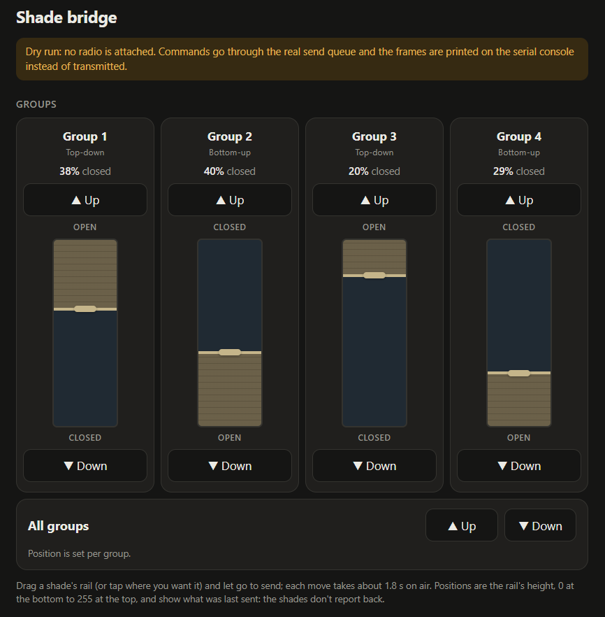

# HD Shade Bridge

An experiment: a simple phone-and-tablet web UI for Hunter Douglas **Platinum Technology** shades, served by an ESP32 on the home network. It's a companion to [HD_Remote_Clone](https://github.com/digamesystems/HD_Remote_Clone), the open replacement for the Platinum handheld remote, and may eventually be folded into that project.

> Personal hobby project. Not affiliated with or endorsed by Hunter Douglas. "Hunter Douglas" and "Platinum" are their trademarks and are used here only to say what this works with.

## Goals

- **Echo some of the Platinum App Bridge's everyday features** in a page that's easy to use from a phone or tablet: setting each group's position, and one-tap scenes (presets). Up/down arrows were left out on purpose: the page only offers controls whose result it can show.
- **Keep it simple.** One small ESP32 firmware, no app to install, and no cloud: the page is served by the device itself.
- **Find out what's worth keeping.** This is largely an experiment. Anything that proves useful is meant to move into HD_Remote_Clone, where the [Web interface and an always-on bridge](https://github.com/digamesystems/HD_Remote_Clone/blob/main/docs/FEATURE_IDEAS.md#web-interface-and-an-always-on-bridge) section of its feature ideas describes the larger plan.

## Status

| Part | State |
|---|---|
| Wi-Fi setup over the serial console, credentials kept in the ESP32's flash | ✅ working: set up by John on the dev module and the handheld; reconnected after every flash and reboot checked over the API since 2026-11-25, and after a move to a phone charger (John, 2026-11-26) |
| Web page and JSON API | ✅ working: used from a phone and a desktop browser; runs on its own from a phone charger after setup (2026-11-26) |
| Send queue with HD_Remote_Clone's frame timings, merging waiting positions | ✅ working: host-tested (11 tests); merging checked on the board in dry run (2026-11-27) and live from a preset saved on the page (0.5.2, John, 2026-11-27). Marked working on 2026-11-26 before any of that; corrected |
| Sending over an nRF24, exactly as HD_Remote_Clone does | ✅ working on HD_Remote_Clone's handheld: Bedtime and a preset saved from the page (Afternoon Sun), alternated 5 times each, with no misses (John, 2026-11-26) |
| Presets: run, save from the page's positions, delete; kept in flash | ✅ working: save, replace, delete, error cases and survival across a reboot checked over the API on the board (2026-11-25); saved and run from the page by John (2026-11-26) |
| Network name, set over serial (`name`), kept in flash | ✅ working: on the handheld, set to `shade-test`, rebooted, found as `shade-test.local` while `shade-bridge.local` was gone, then set back (2026-11-27). Confirmed working by John (2026-11-27) |
| Schedules: a daily clock time for any preset, kept in flash; time from NTP in a time zone set from the page | ✅ working on the handheld, checked over the API in dry run (2026-11-27): time zone set, the bridge's clock matched the PC's, a preset fired in its minute through the queue, schedules and zone survived a reboot, and nothing fired after a reboot inside a schedule's minute. The page's controls confirmed by John on PC and phone (2026-11-27) |
| Remote ID | Borrowed from HD_Remote_Clone's flash on the same board; no ID of its own yet |

The bridge transmits when it finds an nRF24 and a remote ID that HD_Remote_Clone's firmware stored on the board. Otherwise, or after `radio off` on serial, it runs as a **dry run**: every command goes through the real queue, with the real frames and timings, but each frame is printed on the serial console instead of transmitted, and no shade moves. The page shows a banner in dry run, and its footer shows the firmware version and radio state.

## The page



The page follows the device's light or dark setting.

- **One column per group (GRP 1–4).** Each shows the shade as a window with its fabric, and the share of the window the fabric covers ("67%"). Drag the fabric's rail, or tap where you want it, and let go to send that position. Positions snap to whole percentages, so two shades that read the same % get exactly the same position, and a preset saved from them sends them in one frame. There are no up/down arrows: a group command runs a shade all the way to a limit without the page knowing, while a drag always shows where the rail was sent.
- **Shade types.** In this house, groups 1 and 3 are top-down shades and groups 2 and 4 are bottom-up, so the fabric is drawn hanging from the top or rising from the bottom. The types are set in `GROUP_TYPE` in [src/web.cpp](src/web.cpp).
- **Presets:** tap one to run it. To make one, set the shades with the drag controls, open **Save current positions as a preset**, give it a name and tick the groups it should set; unticked groups are left alone when it runs. Groups saved at the same position share one frame on air. **Edit** switches to deleting: tap a preset, confirm, then **Done**. Up to 12 presets, names up to 24 characters, kept in the ESP32's flash. The first boot adds Bedtime, Waketime and Sunset, HD_Remote_Clone's presets; they can be deleted like any other.
- **Schedules:** in **Edit**, each preset has a time and a **Daily** switch: give it a time and it runs every day at that time; clear the time to remove it. A scheduled preset shows "⏰ 10:30 PM daily". The first time, a banner asks for the time zone: one tap takes the phone's. The footer shows the bridge's own clock, the easiest check that it's right. A schedule that's missed (the bridge was off, or rebooting) is skipped, not sent late; if the clocks go back, a time that happens twice runs once; if they go forward, a time that doesn't exist that night doesn't run. The bridge needs internet access for the time (NTP).
- **Activity:** the queue (waiting commands listed in order), a progress bar, a log, and a button to clear the queue. With the radio live, the board can't answer the page while a command is on air (see [How it works](#how-it-works)), so the page doesn't show a command as sending: it pauses, then the log shows the command done. "Sending" and the moving progress bar only appear in dry run.

Positions shown are the last ones *sent*. The shades only receive, so there's no way to read where they actually are.

## Hardware

Any ESP32 dev board with Wi-Fi works for the dry run. This one is developed on an ESP32-DevKitC-style board (ESP32-D0WDQ6, 4 MB flash, CP2102 USB-serial) using PlatformIO's `esp32dev` profile.

To send for real, it needs an nRF24L01+ on VSPI with CE on GPIO 17 and CSN on GPIO 5, as on HD_Remote_Clone's breadboard and handheld PCB (see that project's [WIRING.md](https://github.com/digamesystems/HD_Remote_Clone/blob/main/docs/WIRING.md) and [pin map](https://github.com/digamesystems/HD_Remote_Clone/blob/main/docs/FIRMWARE.md#pin-map)), and a remote ID paired with the shades. For now the bridge borrows the ID that HD_Remote_Clone's firmware keeps in the board's flash (read only; never printed or served), so the easy way to try it is to flash it onto one of HD_Remote_Clone's boards: `pio run -t upload --upload-port COMx`. HD_Remote_Clone's own firmware goes back on with its `pio run -e handheld -t upload`, and its saved settings are untouched. GPIO 4, the IR LED driver on those boards, is held low.

## Quick start

Needs [PlatformIO](https://platformio.org/). `platformio.ini` expects the board on **COM11**; change `upload_port` and `monitor_port` to match yours.

```
pio run -t upload      # build and flash
pio device monitor     # serial console, 115200 baud
pio test -e native     # host tests (needs a C++ compiler on the PC, e.g. MSYS2's g++)
```

Then, in the console:

```
wifi scan
wifi ssid <your network>
wifi pass <your password>
wifi connect
```

The board prints its address when it connects. It also registers a name, `shade-bridge` unless you change it with `name <hostname>` and `reboot`, with your router and over mDNS, so `http://shade-bridge/` (or `http://shade-bridge.lan/`, depending on the router) and `http://shade-bridge.local/` usually work too; some Android phones don't resolve `.local` names. A DHCP reservation on the router keeps the address fixed. It reconnects on its own after a reboot or power cut.

After setup the board needs only USB power: a phone charger will do. The serial console is only for setup (`wifi …`, `web pass`), `radio on|off`, and watching frames go out. Keep it off batteries: Wi-Fi is always on, which would drain a battery in about a day.

The ESP32 only joins **2.4 GHz** Wi-Fi.

## Serial commands

| Command | What it does |
|---|---|
| `wifi scan` | List nearby networks |
| `wifi ssid <name>` / `wifi pass [password]` | Set the network (blank password for an open network) |
| `wifi connect` | Save the settings and connect |
| `wifi status` | Connection details and the page's address |
| `wifi forget` | Erase the saved network |
| `web pass [password]` | Require a login for the page (user `admin`); blank removes it |
| `grp <1-4\|all> <up\|down>` | Group command |
| `pos <mask> <0-255>` | Position. `mask` is hex group bits, e.g. `05` = groups 1 and 3 |
| `presets` | List the presets, with their schedules |
| `schedule <HH:MM\|on\|off\|clear> <preset>` | Set a preset's daily time, switch it on or off, or remove it |
| `tz [zone]` | Show or set the time zone (e.g. `America/Los_Angeles`; US and Canadian zones and UTC), and show the bridge's clock |
| `preset <name>` | Run a preset. A preset's name on its own also works, e.g. `bedtime` |
| `queue` / `clear` | Show the queue / drop jobs that haven't started |
| `name [hostname]` | Show the network name, or set it (letters, digits and `-`, up to 32 characters; `name default` = `shade-bridge`). Takes effect after `reboot` |
| `radio [on\|off]` | Show the radio state, or turn transmitting off (dry run) and on again; on at boot |
| `help`, `reboot` | |

The shade commands use the same names as HD_Remote_Clone's firmware, and the web page and serial console share one queue.

## Web API

`POST` bodies are form-encoded. Commands are queued and answered with `202` straight away, except while a command is on air: the board can't answer then, so a request waits up to about 1.8 s. The queue holds 16 commands; when it's full, commands get `429`. The page polls `/api/status` every second for the queue and the log.

| Endpoint | Purpose |
|---|---|
| `GET /` | The control page |
| `GET /api/status` | Firmware version, network name (`wifi.host`), bridge clock (`time`, "HH:MM", "" until known) and time zone (`tz`), radio state (`live`, `off`, `no radio`, `no remote ID`), queue (with the waiting jobs' labels), last-sent positions, Wi-Fi details, activity log |
| `GET /api/groups` | Shade type per group (`top-down` / `bottom-up`) |
| `GET /api/presets` | Presets: `[{"name":…,"steps":[[mask,pos],…],"time":"22:30","on":true},…]` (`time` is "" with no schedule) |
| `POST /api/grp` | `group=1..4\|all`, `dir=up\|down` (not used by the page) |
| `POST /api/pos` | `group=1..4`, `pos=0..255` |
| `POST /api/preset` | `name=<preset>`: run it |
| `POST /api/preset/save` | `name=<1-24 chars>`, `groups=<1..15>` (group bits), `replace=1` to overwrite. Saves the last-sent positions; refused while the queue is busy or a ticked group's position is unknown |
| `POST /api/preset/delete` | `name=<preset>` (its schedule goes too) |
| `POST /api/preset/schedule` | `name=<preset>`, `time=HH:MM` (empty removes it), `on=1\|0` |
| `POST /api/tz` | `zone=<IANA name>`, e.g. `America/Los_Angeles`; `400` for a zone the bridge doesn't know |
| `POST /api/clear` | Drop queued jobs; the one sending finishes |

Errors come back as `400` (bad request), `404` (no such preset) or `429` (queue full) with `{"ok":false,"error":"..."}`. With a `web pass` set, every route answers `401` until the browser logs in (user `admin`).

## How it works

```
src/main.cpp      serial console, setup and loop
src/net.*         Wi-Fi client, saved settings, mDNS name
src/radio.*       nRF24 transmitter, as HD_Remote_Clone's rf_tools.cpp
src/txqueue.*     send queue and presets kept in flash
lib/bridgecore/   logic with no Arduino code, tested on the PC: the merge rule, hostname checking, schedule timing
test/             host tests (`pio test -e native`)
src/schedules.*   preset schedules, time zone, NTP clock
src/version.h     firmware version
src/web.*         HTTP routes, optional login, shade types
src/page.h        the page: HTML, CSS and script in one string
```

Sending a position takes about 1.8 s on air, and a preset several seconds. The web server and the console run in the same loop, so nothing is sent from inside a request: requests add a job to the queue and return, and the loop sends queued commands one at a time. Each command goes on air exactly as HD_Remote_Clone's `sendGroup()` / `sendPosition()` send it: radio set up, then every phase back to back on ch 33/52/71, each phase starting on 33. The loop waits while a command is on air (up to about 1.8 s), so the page and console pause for that long; between commands, and between a preset's steps, they respond. In dry run nothing waits.

Waiting positions are merged to save air time: groups headed for the same position share one frame, and a newer target for a group replaces one that hasn't been sent. The job being sent is never changed, and nothing merges across a waiting up/down command. Details in [docs/FEATURE_EXPLORATION.md](docs/FEATURE_EXPLORATION.md).

The frame formats and timings come from HD_Remote_Clone's [RF_PROTOCOL.md](https://github.com/digamesystems/HD_Remote_Clone/blob/main/docs/RF_PROTOCOL.md) and [FIRMWARE.md](https://github.com/digamesystems/HD_Remote_Clone/blob/main/docs/FIRMWARE.md):

| Command | Frames (`ID ID MODE GROUP ACTION`) |
|---|---|
| Group up / down | `20 GG A1` / `A2` for 300 ms, then `21` / `22` for 330 ms |
| Position | `50 MM PP` for 1490 ms, then `32 MM PP` for 300 ms |

`GG` is `01/02/04/08` for groups 1–4 or `FF` for All; `MM` is a group mask; `PP` is the position, 0–255.

## Assumptions and open questions

- **Position is the rail's height** on both shade types: 0 at the bottom, 255 at the top. Confirmed on bottom-up shades by HD_Remote_Clone's test (group 4, 2026-11-18) and on top-down shades from this bridge: Sunset put groups 1 and 3 where the page draws them (John, 2026-11-26). So the page's drawing is right for both types. This answers open item 1 in HD_Remote_Clone's feature ideas.
- **No password by default.** The page is open to anyone on the network until `web pass` is set, and the login travels unencrypted over plain HTTP. That was acceptable for a dry run; now that the bridge can move real shades, it needs rethinking.
- **Wi-Fi and the shade radio share 2.4 GHz.** The shades use 2433, 2452 and 2471 MHz, which overlap Wi-Fi channels 6 and 11. In the first test (2026-11-26, Wi-Fi on channel 11) 10 preset runs in a row arrived with Wi-Fi running on the same board. The bridge gets little Wi-Fi traffic beyond the page's own requests (John), so busy Wi-Fi isn't a concern. A miss rate over many more commands hasn't been measured; HD_Remote_Clone saw about 1 miss in 35 group commands without Wi-Fi.

## Next steps

1. Schedules: "around now" (John, 2026-11-27) and the sun trigger. Design in [docs/FEATURE_EXPLORATION.md](docs/FEATURE_EXPLORATION.md#schedules-and-a-sun-trigger).
2. Run the first user test and turn what the tester runs into into page changes: checklist in [docs/FEATURE_EXPLORATION.md](docs/FEATURE_EXPLORATION.md#first-user-test).
3. Measure the miss rate over many more commands.
4. Give the bridge its own remote ID and pair it with the groups it controls.
5. Decide what moves into HD_Remote_Clone, and how.

## License

Copyright © 2026 John Price.

Licensed under the GNU General Public License, version 2 or (at your option) any later version (`GPL-2.0-or-later`), the same as HD_Remote_Clone's firmware, so code can move between the two projects. See [LICENSE](LICENSE). Source files carry an `SPDX-License-Identifier` line.

Protocol facts (frame formats and timings) come from HD_Remote_Clone's documentation, which credits [spitcool/hd-platinum-rf](https://github.com/spitcool/hd-platinum-rf) for the original RF research.
